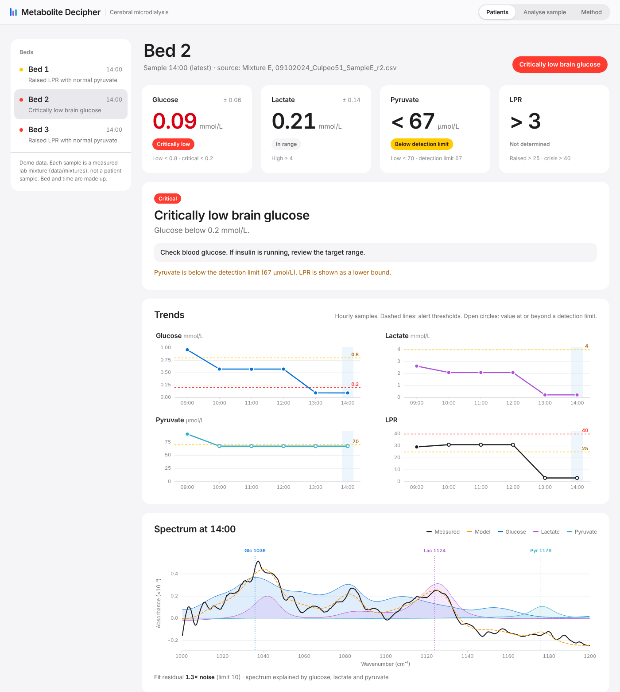
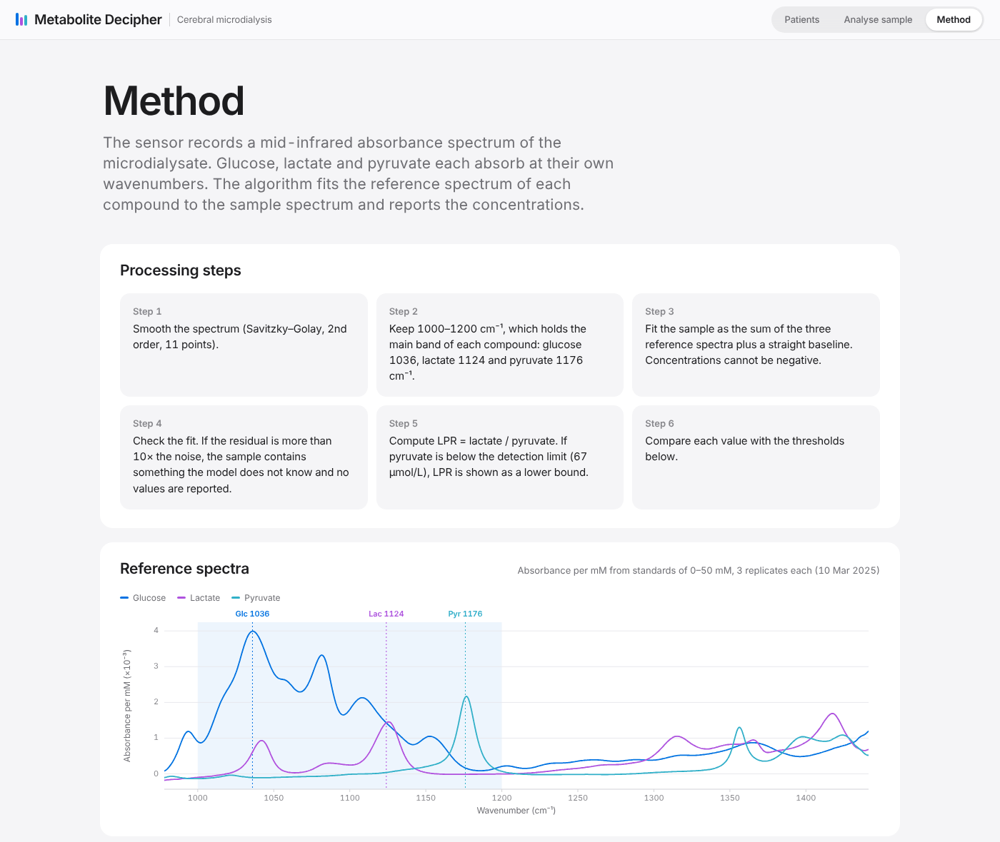

# MD-algorithm

Metabolite decipher in traumatic brain injured patients.

A mid-infrared sensor coupled to cerebral microdialysis gives continuous
readings instead of hourly bedside analysis. This repository turns each
spectrum into glucose, lactate, pyruvate and the lactate/pyruvate ratio (LPR),
and shows them on a web page for clinicians and nurses.



## Run

```
pip install -r requirements.txt
python -m mdalgo.build
```

`mdalgo.build` builds the reference model from the standards, runs the
validation and writes `web/data/`. Then open `web/index.html` in a browser.
No server or internet connection is needed.

Tests:

```
pip install pytest
python -m pytest
```

## Web page

- **Patients**: one bed on continuous monitoring, a reading every 10 min.
  Latest values, alert pattern, a response guide for flagged readings, trends
  and the spectrum with the fitted compounds. The readings are measured
  spectra of synthetic mixtures B, C and E, not patient samples; bed and times are
  made up. Only the last reading (critically low brain glucose) is flagged.
- **Analyse sample**: drop a sensor CSV file to get a result. Files are
  processed in the browser and not sent anywhere.
- **Method**: reference spectra, calibration, validation and thresholds.

## Method

1. Smooth the spectrum (Savitzky–Golay, 2nd order, 11 points).
2. Keep 1000–1200 cm⁻¹. Main bands: glucose 1036, lactate 1124, pyruvate 1176 cm⁻¹.
3. Fit the sample as the sum of the reference spectra (absorbance per mM,
   from standards of 0–50 mM) plus a straight baseline. Concentrations
   cannot be negative.
4. If the fit residual is more than 10× the noise, the spectrum has bands the
   model does not know. No values are reported.
5. LPR = lactate / pyruvate. If pyruvate is below the detection limit, LPR is
   shown as a lower bound.
6. Flag the reading. Critical thresholds (glucose < 0.2 mmol/L, LPR > 40) flag
   on the measured value. Warning thresholds flag only when the value is past
   them by more than its measurement error; otherwise the value is shown as
   near threshold. This stops readings with an uncertain LPR from raising
   alarms.

The fit runs in Python (`mdalgo/model.py`) and in the browser
(`web/js/fit.js`). A test checks that both give the same numbers.



## Results

Calibration, standards 0–300 mM:

| Compound | Band (cm⁻¹) | Absorbance per mM | R² |
|---|---|---|---|
| Glucose | 1036 | 4.23 × 10⁻³ | 0.999 |
| Lactate | 1124 | 1.42 × 10⁻³ | 0.997 |
| Pyruvate | 1176 | 2.15 × 10⁻³ | 0.999 |

Synthetic mixtures, known / measured (mean of 3 replicates):

| Mixture | Glucose (mmol/L) | Lactate (mmol/L) | Pyruvate (µmol/L) |
|---|---|---|---|
| A | 3.00 / 2.89 | 5.00 / 5.20 | 20 / 124 |
| B | 1.50 / 1.45 | 3.00 / 3.19 | 140 / 92 |
| C | 1.00 / 0.96 | 2.50 / 2.63 | 110 / 89 |
| D | 0.60 / 0.57 | 2.00 / 2.09 | 90 / 60 |
| E | 0.10 / 0.09 | 0.20 / 0.21 | 30 / 50 |

Root-mean-square error: glucose 0.06 mmol/L, lactate 0.14 mmol/L, pyruvate
54 µmol/L. Pyruvate detection limit: 67 µmol/L.

## Clinical thresholds

Set in `web/js/clinical.js`.

| Measure | Threshold | Meaning |
|---|---|---|
| Glucose | < 0.8 mmol/L | Low brain glucose |
| Glucose | < 0.2 mmol/L | Critically low |
| LPR | > 25 | Raised |
| LPR | > 40 | Crisis threshold. With glucose < 0.2: metabolic crisis |
| Pyruvate | < 70 µmol/L | With raised LPR: ischaemic pattern. Above it: mitochondrial dysfunction |
| Lactate | > 4 mmol/L | High |

Sources: Hutchinson et al., Intensive Care Med 2015;41:1517–28 (2014
International Microdialysis Forum consensus); Nielsen et al., Acta
Anaesthesiol Scand 2013; Reinstrup et al., Neurosurgery 2000.

## Response guides

Flagged readings show what to do, with sources. Text and references are in
`web/js/clinical.js`.

**Low brain glucose**

1. Confirm the reading: next reading, catheter, pump, tubing, check standard.
   If lactate and pyruvate are also very low, suspect a sampling fault.
2. Check blood glucose and insulin. Tight control (4.4–6.1 mmol/L) gives more
   low brain glucose and metabolic crisis (Oddo 2008; Vespa 2012; Plummer 2018).
3. Blood glucose below 6 mmol/L or a tight target: reduce insulin, aim for
   6–10 mmol/L, feed or give glucose (Meierhans 2010; NICE-SUGAR 2009;
   Kofler 2017).
4. Blood glucose already 6–10 mmol/L: treat ICP > 20 mmHg, bring PbtO₂ to
   ≥ 15 mmHg, keep CPP 60–70 mmHg or where PRx ≤ 0.3, aim for brain glucose
   ≥ 1 mmol/L, check the EEG for seizures (Khellaf 2022; Carney 2017;
   Hutchinson 2015; Sharma 2023).
5. Follow the next readings.

**Raised LPR**

1. Confirm the reading.
2. Correct supply in the same order as above (Khellaf 2022).
3. LPR still > 25: mitochondrial dysfunction. No standard treatment; focal
   succinate lowered LPR by 12% and raised brain glucose by 17% in a small
   study (Khellaf 2022).
4. Follow the next readings.

Continuous monitoring follows Zimphango et al., Metabolites 2022: hourly
bedside analysis misses changes within the hour.

## Limits

- Pyruvate in the clinical range is close to the detection limit, so LPR is
  approximate. In mixture A, LPR reads 42 instead of 250.
- Patient spectra (17 Oct 2024) have bands at about 1020, 1160 and
  1360 cm⁻¹ that are not in the standards. All of them fail the fit check, and
  the values do not yet agree with the ISCUS analyser.
- Sensitivity changes between sessions (the pyruvate series read 1.37× the
  prepared value). Run a 1 mM check standard at the start of each session.

## Data

All files are CSV with a header row and two columns: wavenumber (cm⁻¹) and
Naperian absorbance.

| Folder | Content |
|---|---|
| `data/standards` | Glucose, lactate and pyruvate 1–300 mM and blanks, 3 replicates (10 Mar 2025) |
| `data/mixtures` | Mixtures A–E, 1 mM standards and perfusion fluid (9 Oct 2024). Known values in `concentrations.csv` |
| `data/pyruvate` | Pyruvate 0–1 mM, 3 replicates |
| `data/patient` | Not in the repository. Put patient sensor files and `iscus.csv` here to print the comparison with ISCUS |

## Layout

```
mdalgo/      spectra.py (read, smooth), model.py (fit), build.py (validation, web data)
web/         index.html, css/, js/ (fit, clinical rules, charts, app), data/ (generated)
tests/       model tests and the Python/browser check
```
